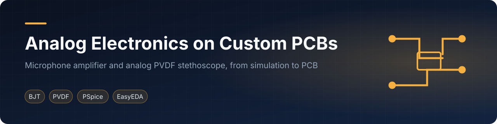
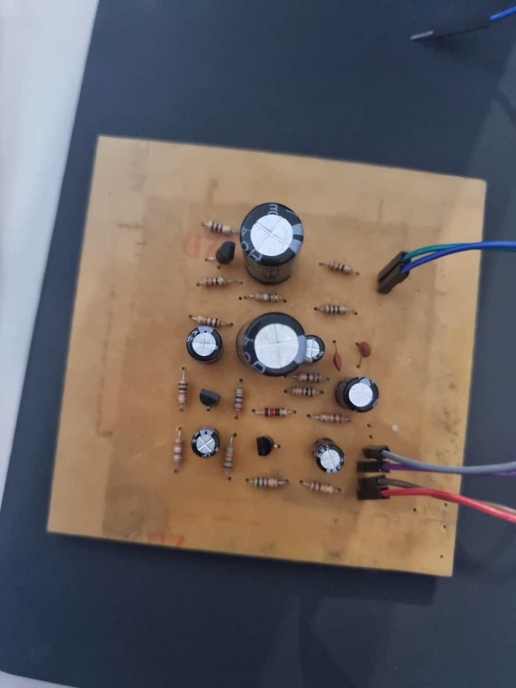
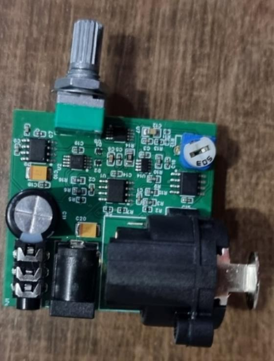

  

<a href="#english">English</a> · <a href="#español">Español</a>

## English

Hardware projects by Elías David Álvarez Martínez (Electronics Engineering, Universidad Católica "Nuestra Señora de la Asunción", Paraguay). Each project contains the technical report, PCB exports, simulation material and its own README.

| | Project | Summary |
|---|---|---|
|  | **[Electret Microphone Amplifier](projects/01-electret-microphone-amplifier)** | Three-stage 2N2222 common-emitter amplifier, target gain of 70 into a 32 Ω load. Hand-etched PCB; output measured above 70 times the input. |
|  | **[Analog Electronic Stethoscope (PVDF)](projects/02-analog-electronic-stethoscope)** | Charge amplifier, INA128, 650 Hz low-pass and LM386 audio stage for heart-sound pickup. Fully analog design, simulated in PSpice and fabricated on a PCB. A later digital redesign lives in [dsp-psoc5lp](https://github.com/simplementeUnPorito/dsp-psoc5lp). |

### License
MIT. Reports and figures are shared for reference. Third-party datasheets and papers are not redistributed; each project README lists them.

## Español

Proyectos de hardware de Elías David Álvarez Martínez (Ingeniería Electrónica, Universidad Católica "Nuestra Señora de la Asunción", Paraguay). Cada proyecto incluye el informe técnico, exportaciones de PCB, material de simulación y su propio README.

| | Proyecto | Resumen |
|---|---|---|
|  | **[Amplificador para micrófono electret](projects/01-electret-microphone-amplifier)** | Amplificador de tres etapas emisor común con 2N2222, ganancia objetivo de 70 sobre 32 Ω. PCB hecha a mano; salida medida superior a 70 veces la entrada. |
|  | **[Estetoscopio electrónico analógico (PVDF)](projects/02-analog-electronic-stethoscope)** | Amplificador de carga, INA128, pasa-bajos de 650 Hz y etapa de audio LM386 para captar sonidos cardíacos. Diseño totalmente analógico, simulado en PSpice y fabricado en PCB. El rediseño digital posterior está en [dsp-psoc5lp](https://github.com/simplementeUnPorito/dsp-psoc5lp). |

### Licencia
MIT. Los informes y figuras se comparten como referencia. Las hojas de datos y artículos de terceros no se redistribuyen; cada README de proyecto los enumera.
