<p align="center">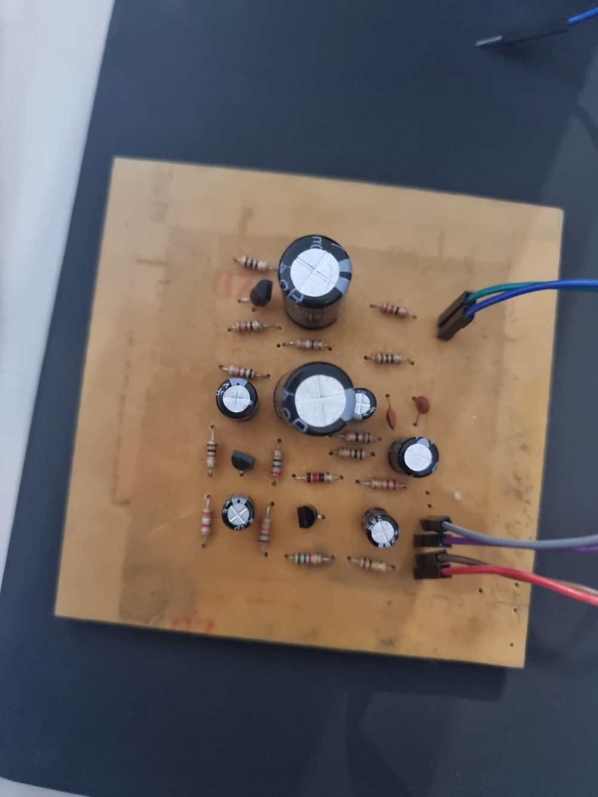</p>
<h1 align="center">Electret Microphone Amplifier</h1>
<p align="center"><b>Three-cascaded-stage BJT amplifier, from hand calculation and PSpice to a hand-etched PCB.</b><br>
  </p>
<p align="center"><a href="#english">English</a> · <a href="#español">Español</a></p>

## English
### Overview
An amplifier for an electret microphone with a total voltage gain of 70 (load included) into a 32 Ω load (10 Ω in series with 22 Ω) and an input impedance compatible with the microphone. The gain is split over three class A common-emitter stages built with 2N2222 transistors, to avoid distortion and clipping. The design was calculated by hand (DC and AC analysis, symmetric-swing bias), verified in PSpice including a Monte Carlo run, laid out in EasyEDA and built on a home-made board.

### Highlights
- Supply of 12 V; design gains of -10, -7 and -1 V/V for stages 1, 2 and 3, with 1 mA / 6 mA / 60 mA collector currents.
- Calculated vs. simulated stage gains: -10.54 / -10.04, -7.349 / -7.059 and -1.081 / -1.062 V/V.
- Monte Carlo run with component tolerances: 96 % probability of reaching at least 90 % of the required gain.
- Low-frequency cutoff designed at 20 Hz (coupling and bypass capacitors up to 3.3 mF in stage 3).
- Oscilloscope measurements show an output above 70 times the input.
- The PCB was redesigned with thicker traces and a larger outline after iron-on transfer failed (four copper boards used); the final board was made with the marker-and-acid technique.

### System architecture


### Hardware
| Component | Role |
|---|---|
| 2N2222 (x3) | Class A common-emitter gain stages |
| Electret microphone | Input transducer (datasheet in the report) |
| Divider, emitter and collector resistors | Bias and gain setting |
| Coupling, bypass and supply-decoupling capacitors | 20 Hz high-pass and supply noise filtering |
| 10 Ω + 22 Ω | 32 Ω output load |

### Repository layout
```
docs/img/                   photos, schematic and layout figures
hardware/pcb/               EasyEDA exports: copper layouts, board and silkscreen PDFs, Gerber zip
simulation/                 PSpice result plots taken from the report
```

### Getting started
The schematic and layout were made in EasyEDA; open the Gerber files in any viewer or upload `hardware/pcb/gerber.zip` to a fabricator. The PSpice schematic source files are not part of this archive; the report documents the simulations and `simulation/` holds their result figures.

### Results
| | |
|---|---|
| 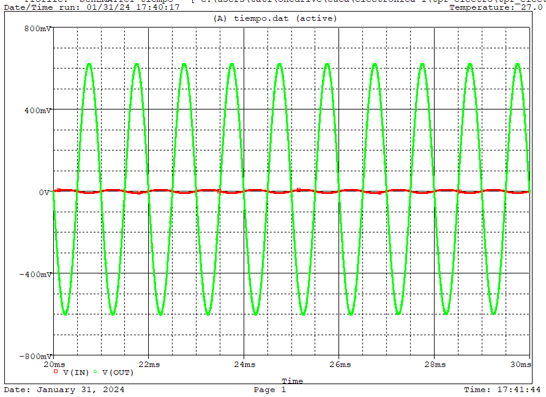 | Simulated input and output at 1 kHz |
| 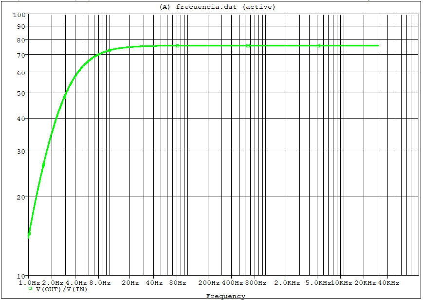 | Simulated gain vs. frequency |
| 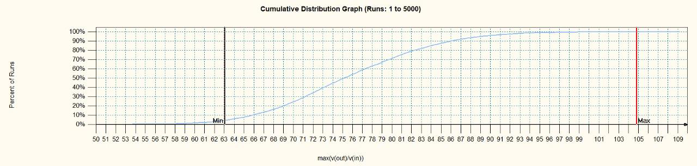 | Monte Carlo cumulative distribution of the gain |
| 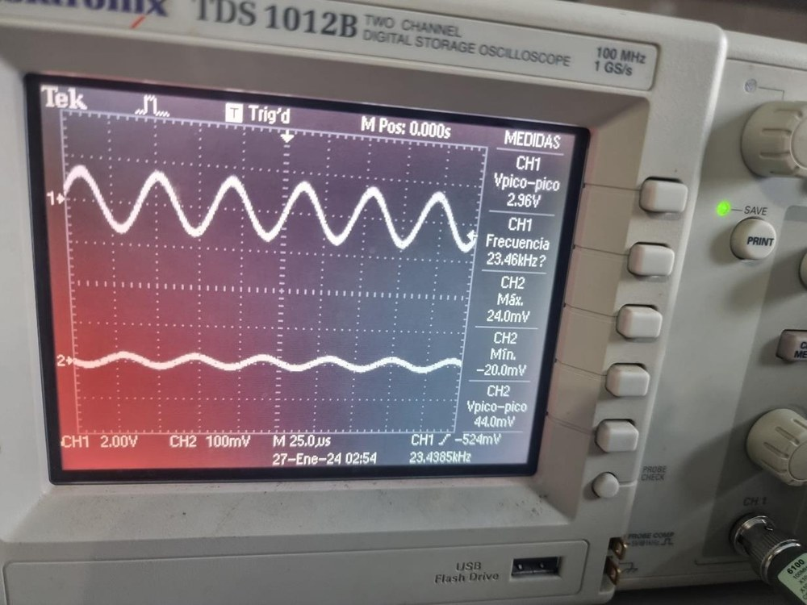 | Measured input (channel 2) and output (channel 1) |

The report also discusses noise with generic power supplies and proposes improvements (for example a ceramic capacitor between base and collector of each stage against oscillation).

### PCB
Layouts, board and silkscreen PDFs and the Gerber set are in [`hardware/pcb/`](hardware/pcb/).

<p align="center">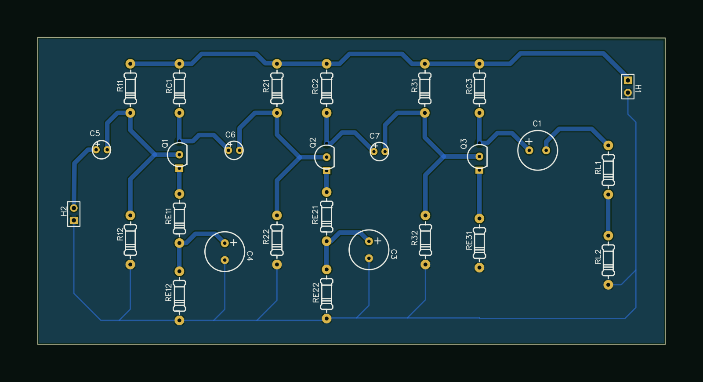<br><i>Board render (top view, bottom copper shown dimmed); EasyEDA sources in <code>hardware/easyeda/</code></i></p>

<p align="center">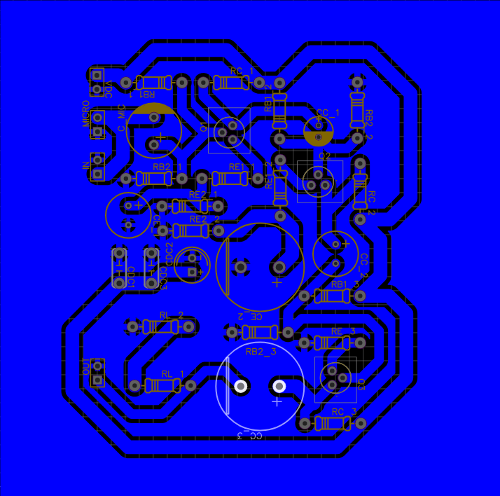 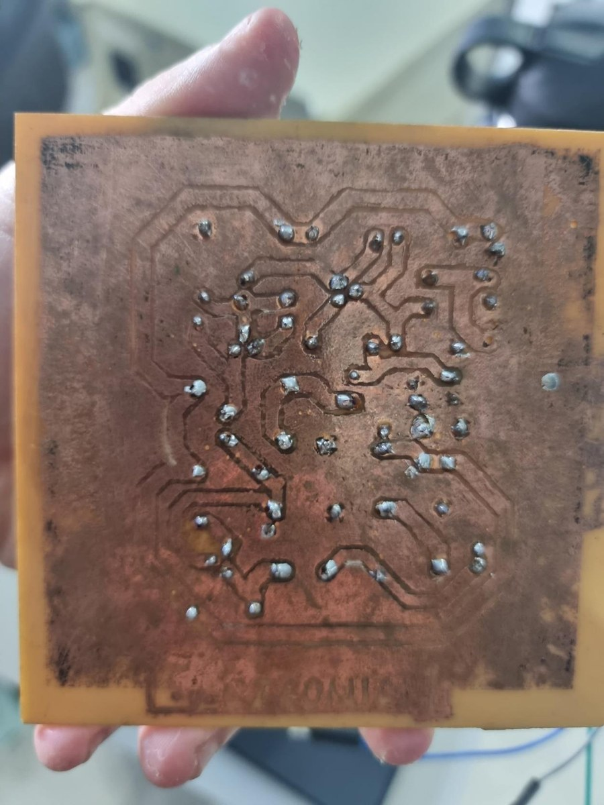</p>

### Prototype photos
<table><tr>
<td align="center" width="25%">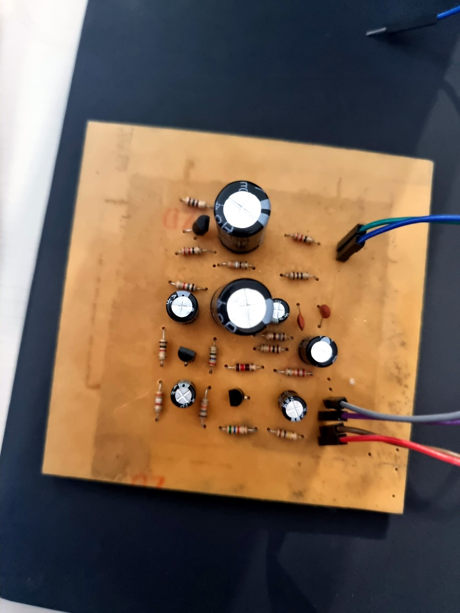<br><sub>Etched amplifier PCB with discrete components</sub></td><td align="center" width="25%">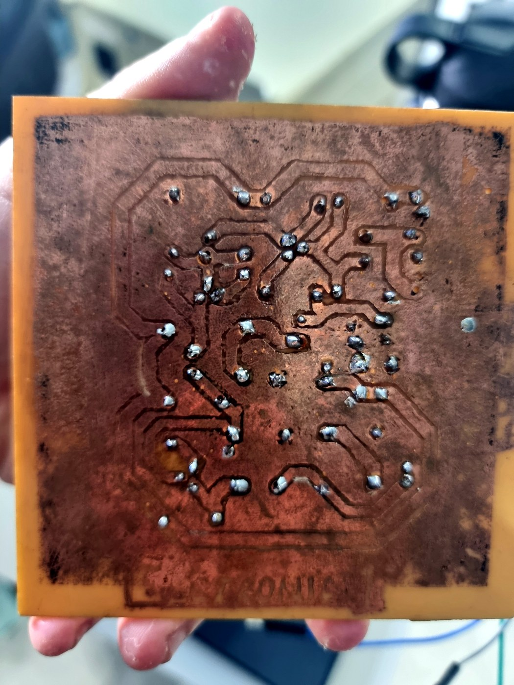<br><sub>Solder side of etched amplifier PCB</sub></td><td align="center" width="25%"><br><sub>Oscilloscope showing amplified sine output</sub></td><td align="center" width="25%">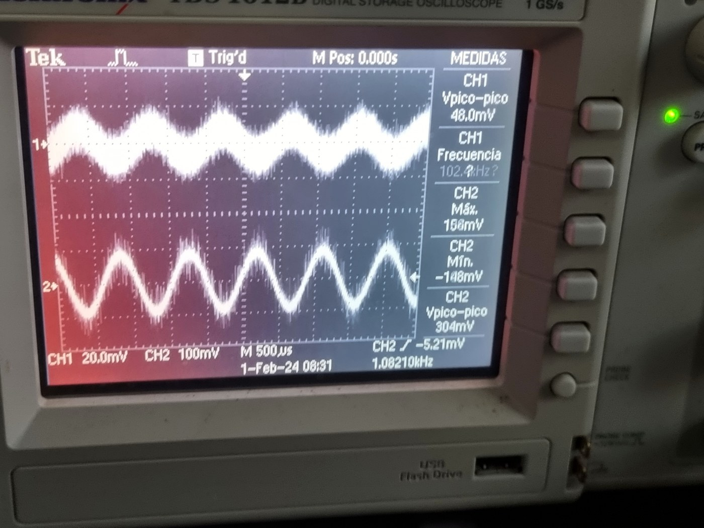<br><sub>Noisy input and clean amplified sine</sub></td>
</tr></table>

### Team & credits
Developed by Elías Álvarez and Tania Romero at Universidad Católica "Nuestra Señora de la Asunción" (Paraguay), 2024. Advisor: Lucas Frutos.

### License
MIT, see [LICENSE](../../LICENSE). The report and figures are shared for reference.

## Español
### Descripción
Amplificador para micrófono electret con ganancia de tensión total de 70 (carga incluida) sobre una carga de 32 Ω (10 Ω en serie con 22 Ω) e impedancia de entrada compatible con el micrófono. La ganancia se reparte en tres etapas clase A en emisor común con transistores 2N2222 para evitar distorsión y recorte. El diseño se calculó a mano (análisis DC y AC, polarización de máxima excursión simétrica), se verificó en PSpice con simulación de Montecarlo, se diseñó en EasyEDA y se montó en una placa casera.

### Puntos destacados
- Alimentación de 12 V; ganancias de diseño de -10, -7 y -1 V/V en las etapas 1, 2 y 3, con corrientes de colector de 1 mA / 6 mA / 60 mA.
- Ganancias calculadas vs. simuladas: -10,54 / -10,04, -7,349 / -7,059 y -1,081 / -1,062 V/V.
- Montecarlo con tolerancias de componentes: 96 % de probabilidad de alcanzar al menos el 90 % de la ganancia requerida.
- Corte inferior diseñado en 20 Hz.
- Las mediciones con osciloscopio muestran una salida superior a 70 veces la entrada.
- La PCB se rediseñó con pistas más gruesas y mayor tamaño tras fallar la transferencia por plancha (cuatro placas de cobre); la placa final se hizo con marcador y ácido.

### Arquitectura, hardware y estructura
Ver los diagramas y tablas de la sección en inglés. `hardware/pcb/` contiene las exportaciones de EasyEDA; `simulation/` contiene las figuras de resultados de PSpice.

### Cómo usarlo
Abrir los archivos Gerber en cualquier visor o subir `hardware/pcb/gerber.zip` a un fabricante. Los archivos fuente de PSpice no forman parte de este archivo; el informe documenta las simulaciones.

### Resultados
Ver las figuras de la sección en inglés (transitorio a 1 kHz, respuesta en frecuencia, Montecarlo y medición en osciloscopio).

### PCB
Ver [`hardware/pcb/`](hardware/pcb/). Render 3D pendiente de exportar desde EasyEDA.

### Fotos del prototipo
<table><tr>
<td align="center" width="25%"><br><sub>Etched amplifier PCB with discrete components</sub></td><td align="center" width="25%"><br><sub>Solder side of etched amplifier PCB</sub></td><td align="center" width="25%"><br><sub>Oscilloscope showing amplified sine output</sub></td><td align="center" width="25%"><br><sub>Noisy input and clean amplified sine</sub></td>
</tr></table>

### Equipo y créditos
Desarrollado por Elías Álvarez y Tania Romero en la Universidad Católica "Nuestra Señora de la Asunción" (Paraguay), 2024. Tutor: Lucas Frutos.

### Licencia
MIT. El informe y las figuras se comparten como referencia.
