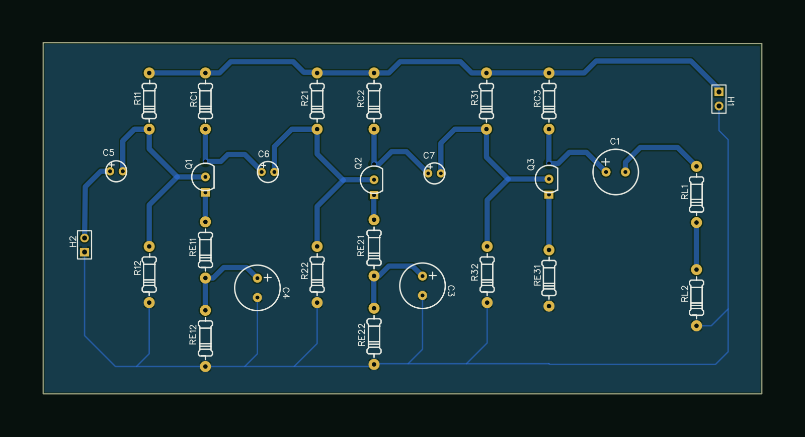

# PCB exports

Source: EasyEDA project (layout designed for home fabrication).

| File | Content |
|---|---|
| `render-top.png`, `render-schematic.png` | Renders generated from the EasyEDA JSON sources in `../easyeda/` |
| `gerber.zip` | Gerber and drill files exported on 2023-12-28 (top/bottom copper, silkscreen, solder mask, outline, drill) |
| `pcb-copper-layout-2024-01-04.png`, `pcb-copper-layout-2024-01-29-a.png`, `-b.png` | Copper layout renders of successive iterations |
| `board-initial-fine-traces.pdf`, `silkscreen-initial.pdf` | First, fine-trace design (not feasible with iron-on transfer) |
| `board-final-thick-traces.pdf`, `silkscreen-final.pdf`, `board-composite-2024-01-05.pdf` | Final, thick-trace design |

 <i>Top view, bottom copper shown dimmed</i>

