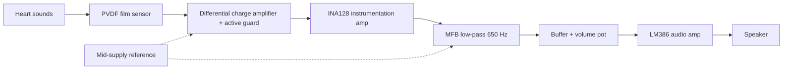
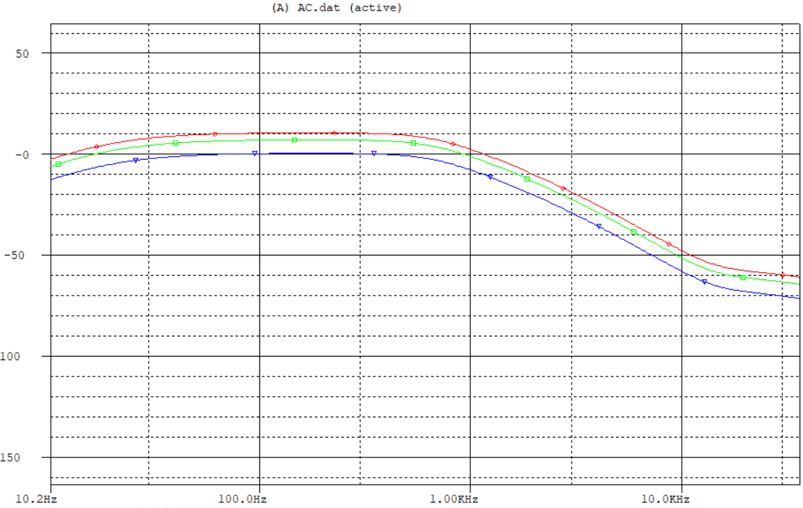
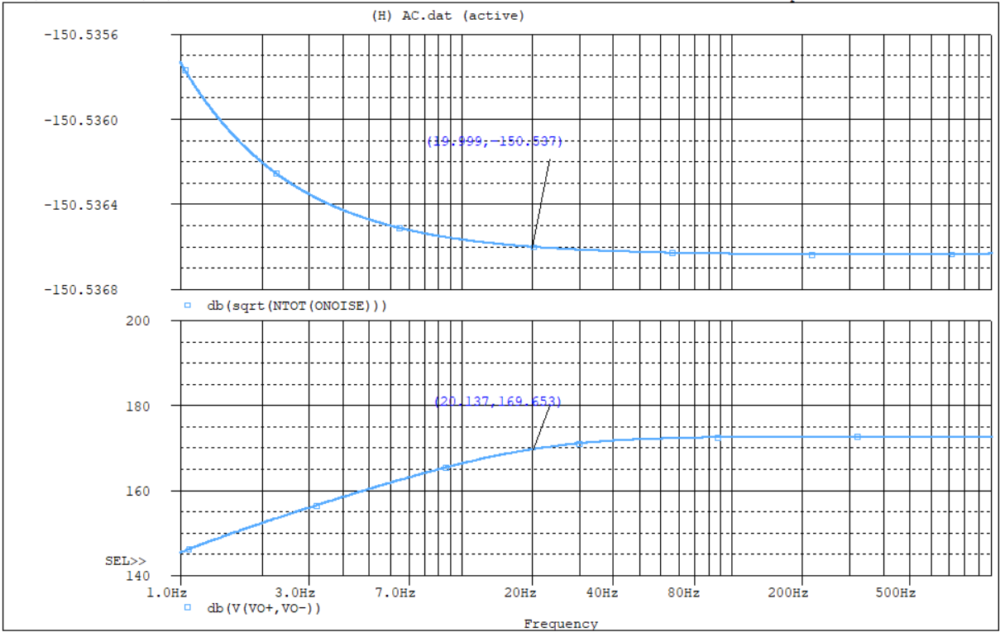
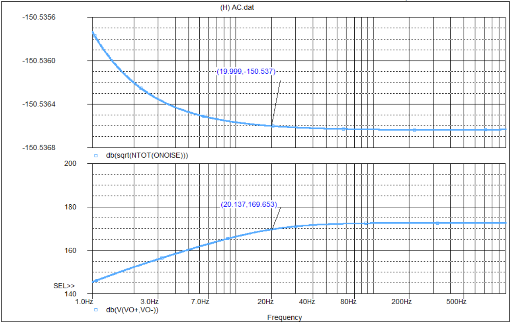
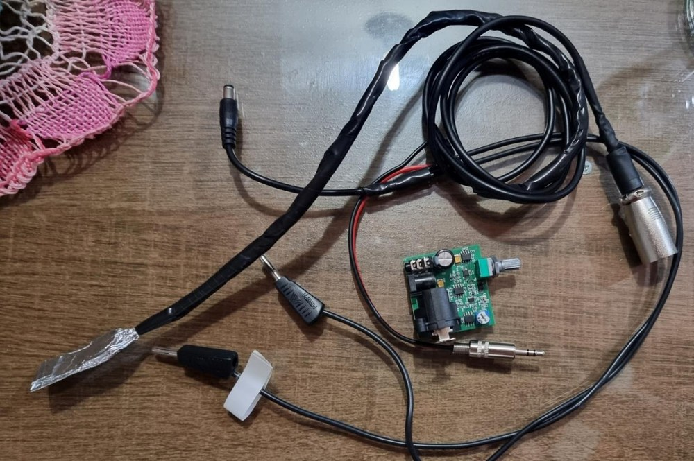
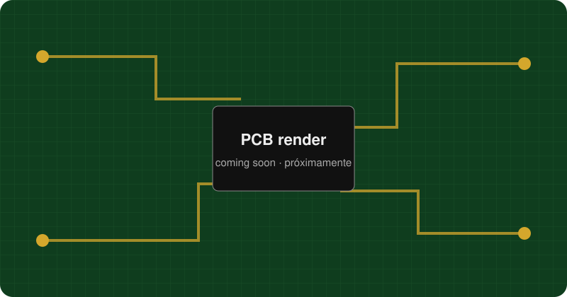
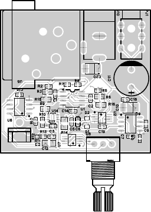

<p align="center"></p>
<h1 align="center">PVDF Electronic Stethoscope: Analog Front-End</h1>
<p align="center"><b>Single-supply analog chain that turns a PVDF film signal into heart-sound audio.</b><br>
  </p>
<p align="center"><a href="#english">English</a> · <a href="#español">Español</a></p>

## English
### Overview
An electronic stethoscope that picks up heart sounds with a PVDF piezoelectric film sensor and processes them with op-amps and an instrumentation amplifier into an audio signal for a speaker. The chain was designed from the sensor model (acoustic impedance, charge generation), simulated stage by stage in PSpice, laid out in EasyEDA and fabricated. Testing showed the board overheating near the instrumentation amplifier; the report analyses the likely causes.

### Highlights
- Differential charge amplifier based on a Maxim piezofilm application note, with feedback capacitor Cf = 4.7 nF and a resistor T-network (15 kΩ, 180 kΩ, 1.8 kΩ; 1.695 MΩ equivalent) for a 20 Hz high-pass without a huge resistor. Values were obtained by constrained optimisation (KKT).
- Active guard (OPA350 buffer) and shielded XLR cable to reject interference.
- Single-supply operation with a mid-supply reference buffer (OPA337, 2 x 100 kΩ divider).
- INA128 instrumentation amplifier with trimmer-set gain G = 1 + 50 kΩ / RG.
- Multiple-feedback low-pass at 650 Hz (OPA350, designed with the TI filter design tool) and an LM386 audio stage with passive 20 Hz high-pass, 650 Hz low-pass and Schottky input protection.
- Two PCB layouts designed in EasyEDA; the compact one was manufactured.

### System architecture


### Hardware
| Component | Role |
|---|---|
| PVDF piezo film (Cs 1.2 nF, 110 mm² effective area) | Pressure-to-charge sensor |
| OPA338 (dual) | Differential charge amplifier and T-network high-pass |
| OPA350 | Active guard and 650 Hz low-pass filter |
| OPA337 | Mid-supply reference and volume buffer |
| INA128 | Instrumentation amplifier, adjustable gain |
| LM386 | Audio power stage for an 8 Ω speaker |
| XLR cable, DC jack | Sensor connection and power |

### Repository layout
```
docs/img/                   photos, stage schematics, block diagram
hardware/pcb/               EasyEDA layout exports (PDF, PNG) and 3D render placeholder
simulation/                 OrCAD Capture/PSpice schematics (.dsn), result plots
```

### Getting started
Open `simulation/*.dsn` with OrCAD Capture / PSpice (the project used Cadence SPB 23.1). Simulation profiles and caches were not included, and the TI vendor PSpice models (INA128, OPA337/338/350) must be added from the manufacturer. Projects: power/reference (`Alimentación`), `INA128`, filter stage (`etapaFiltro`) and `VREG`.

### Results
| | |
|---|---|
|  | Simulated AC response of the final circuit |
|  | Pre-amplifier noise and output |
|  | Filter stage noise and output |
|  | Assembled board with sensor and cables |

Outcome: on first power-up the board produced signal briefly, then heated up around the instrumentation amplifier and stopped working. The report attributes this to a sub-optimal PCB design (heat dissipation), limited time for testing, and difficulty sourcing imported ICs. The modular design approach allowed most stages to be developed and simulated successfully.

### PCB
Two layouts are provided. The compact layout (`layout-compact.pdf`) matches the board built and photographed in the report.

<p align="center"><br><i>3D render, to be exported from EasyEDA</i></p>
<p align="center"> </p>

### References (not redistributed)
- Maxim, "Amplifier Provides Signal Conditioning for Piezofilm Sensor", Application Note 1127.
- Measurement Specialties, "Piezo Film Sensors Technical Manual" (1999).
- Texas Instruments datasheets: INA12x family, OPA337/OPA338, OPA350, LM386.
- B. Carter, "A Single-Supply Op-Amp Circuit Collection", Texas Instruments (2000); T. Noyes, "Understanding Op Amp Noise in Audio Circuits", Texas Instruments (2022).
- V. Gross et al., "The Relationship between Normal Lung Sounds, Age, and Gender", Am J Respir Crit Care Med 162 (2000).
- Further clinical and application references are listed in the report.

### Team & credits
Developed by Elías Álvarez and Tania Romero at Universidad Católica "Nuestra Señora de la Asunción" (Paraguay), 2024. A later, separate project redesigned the stethoscope with digital signal processing on a PSoC 5LP: [dsp-psoc5lp](https://github.com/simplementeUnPorito/dsp-psoc5lp).

### License
MIT, see [LICENSE](../../LICENSE). Figures are shared for reference.

## Español
### Descripción
Estetoscopio electrónico que capta sonidos cardíacos con un sensor piezoeléctrico de película PVDF y los procesa con amplificadores operacionales y un amplificador de instrumentación hasta obtener una señal de audio para un altavoz. La cadena se diseñó a partir del modelo del sensor, se simuló etapa por etapa en PSpice, se diseñó en EasyEDA y se fabricó. En las pruebas la placa se sobrecalentó cerca del amplificador de instrumentación; el informe analiza las causas probables.

### Puntos destacados
- Amplificador de carga diferencial (nota de aplicación de Maxim), Cf = 4,7 nF y red en T (15 kΩ, 180 kΩ, 1,8 kΩ; 1,695 MΩ equivalentes) para un pasa-altas de 20 Hz, con valores obtenidos por optimización (KKT).
- Guarda activa (OPA350) y cable XLR blindado.
- Fuente única con buffer de referencia a media alimentación (OPA337).
- INA128 con ganancia ajustable G = 1 + 50 kΩ / RG.
- Filtro pasa-bajos MFB de 650 Hz y etapa de audio LM386 con protección Schottky.
- Dos diseños de PCB en EasyEDA; se fabricó el compacto.

### Resultado
En el primer encendido la placa entregó señal brevemente y luego se calentó alrededor del amplificador de instrumentación y dejó de funcionar. El informe lo atribuye a un diseño de PCB subóptimo (disipación de calor), poco tiempo de prueba y dificultad para conseguir circuitos integrados importados.

### Uso, estructura y PCB
Ver las secciones en inglés. Abrir `simulation/*.dsn` con OrCAD Capture/PSpice (se requieren los modelos de TI). Las exportaciones de EasyEDA están en `hardware/pcb/`; el render 3D está pendiente de exportar.

### Equipo y créditos
Desarrollado por Elías Álvarez y Tania Romero en la Universidad Católica "Nuestra Señora de la Asunción" (Paraguay), 2024. Un proyecto posterior e independiente rediseñó el estetoscopio con procesamiento digital en PSoC 5LP: [dsp-psoc5lp](https://github.com/simplementeUnPorito/dsp-psoc5lp).

### Licencia
MIT. El informe y las figuras se comparten como referencia.
