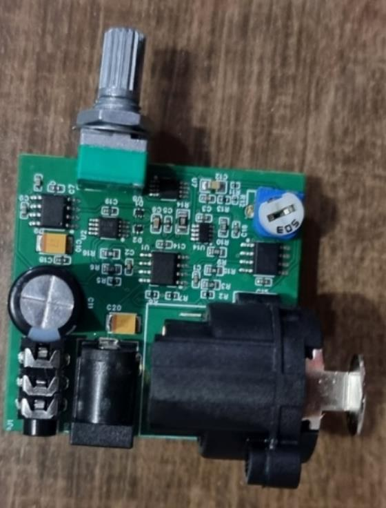
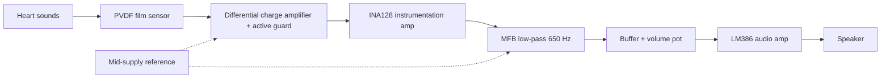
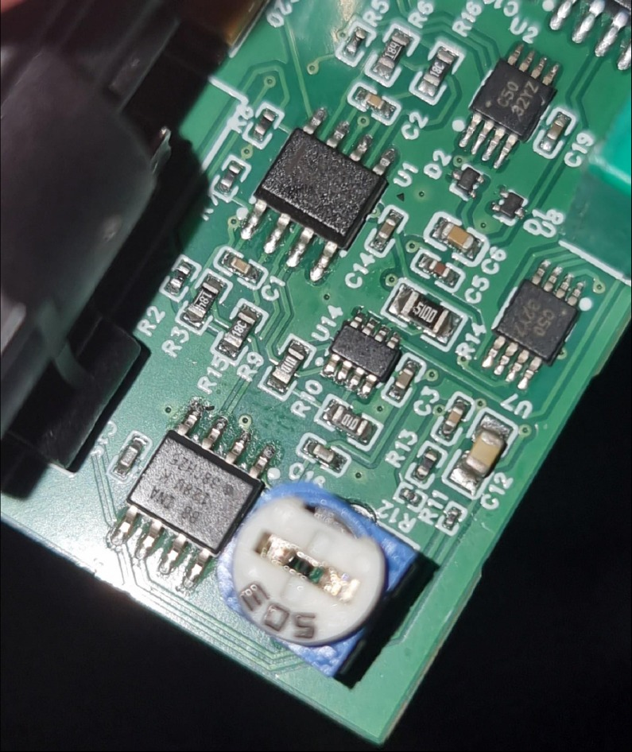
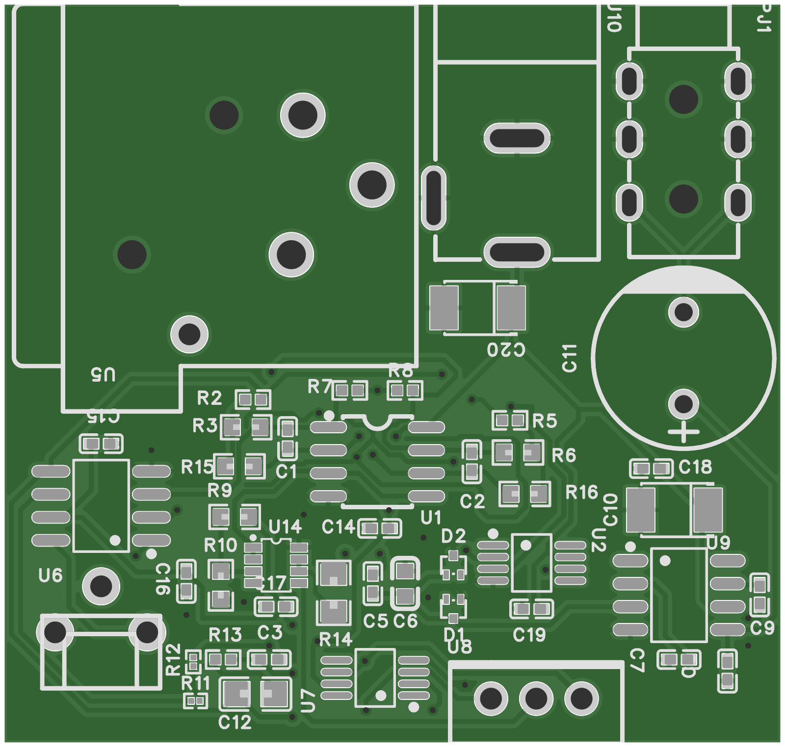
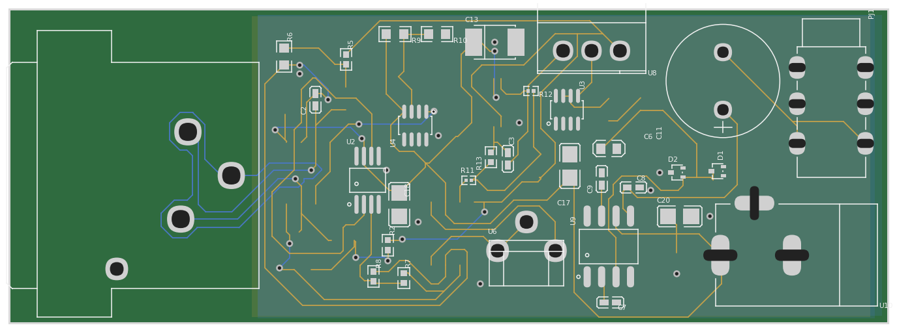
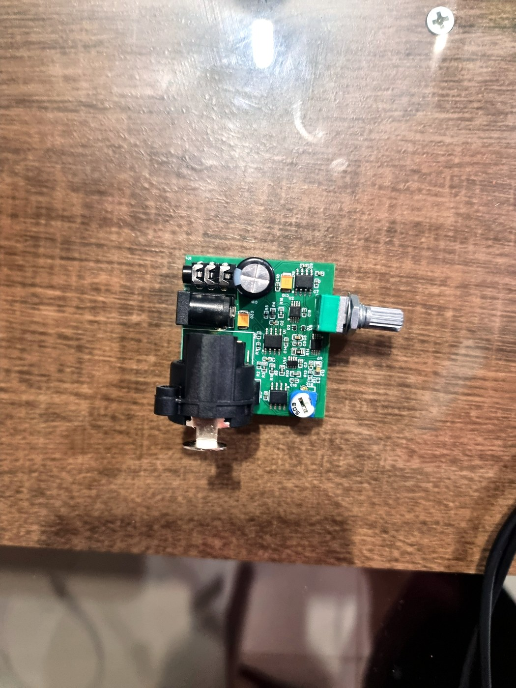

<p align="center"></p>
<h1 align="center">PVDF Electronic Stethoscope: Analog Front-End</h1>
<p align="center"><b>Single-supply analog chain that turns a PVDF film signal into heart-sound audio.</b><br>
  </p>
<p align="center"><a href="#english">English</a> · <a href="#español">Español</a></p>

## English
### Overview
An electronic stethoscope that picks up heart sounds with a PVDF piezoelectric film sensor and processes them with op-amps and an instrumentation amplifier into an audio signal for a speaker. The chain was designed from the sensor model (acoustic impedance, charge generation), simulated stage by stage in PSpice, laid out in EasyEDA and fabricated. Testing showed the board overheating near the instrumentation amplifier; the report analyses the likely causes.

### Highlights
- Differential charge amplifier based on a Maxim piezofilm application note, with feedback capacitor Cf = 4.7 nF and a resistor T-network (15 kΩ, 180 kΩ, 1.8 kΩ; 1.695 MΩ equivalent) for a 20 Hz high-pass without a huge resistor. Values were obtained by constrained optimisation (KKT).
- Active guard (OPA350 buffer) and shielded XLR cable to reject interference.
- Single-supply operation with a mid-supply reference buffer (OPA337, 2 x 100 kΩ divider).
- INA128 instrumentation amplifier with trimmer-set gain G = 1 + 50 kΩ / RG.
- Multiple-feedback low-pass at 650 Hz (OPA350, designed with the TI filter design tool) and an LM386 audio stage with passive 20 Hz high-pass, 650 Hz low-pass and Schottky input protection.
- Three PCB layouts designed in EasyEDA; the compact one was manufactured.

### System architecture


### Hardware
| Component | Role |
|---|---|
| PVDF piezo film (Cs 1.2 nF, 110 mm² effective area) | Pressure-to-charge sensor |
| OPA338 (dual) | Differential charge amplifier and T-network high-pass |
| OPA350 | Active guard and 650 Hz low-pass filter |
| OPA337 | Mid-supply reference and volume buffer |
| INA128 | Instrumentation amplifier, adjustable gain |
| LM386 | Audio power stage for an 8 Ω speaker |
| XLR cable, DC jack | Sensor connection and power |

### Repository layout
```
docs/img/                   photos, stage schematics, block diagram
hardware/pcb/               EasyEDA layout exports (PDF, PNG) and board renders
hardware/easyeda/           EasyEDA Pro project of the long alternative layout
simulation/                 OrCAD Capture/PSpice schematics (.dsn), result plots
```

### Getting started
Open `simulation/*.dsn` with OrCAD Capture / PSpice (the project used Cadence SPB 23.1). Simulation profiles and caches were not included, and the TI vendor PSpice models (INA128, OPA337/338/350) must be added from the manufacturer. Projects: power/reference (`Alimentación`), `INA128`, filter stage (`etapaFiltro`) and `VREG`.

### Results
| | |
|---|---|
|  | Simulated AC response of the final circuit |
|  | Pre-amplifier noise and output |
|  | Filter stage noise and output |
|  | Assembled board with sensor and cables |

Outcome: on first power-up the board produced signal briefly, then heated up around the instrumentation amplifier and stopped working. The report attributes this to a sub-optimal PCB design (heat dissipation), limited time for testing, and difficulty sourcing imported ICs. The modular design approach allowed most stages to be developed and simulated successfully.

<p align="center"><br><i>Close-up of the fabricated board around the instrumentation-amplifier section that overheated during initial testing.</i></p>

### PCB
Three layouts exist. The compact two-layer board (43 x 41 mm, `layout-compact.pdf`) is the one that was manufactured and photographed. The image below is rendered from its fabrication Gerber files, so it shows the copper, pads and silkscreen exactly as produced.

<p align="center"><br><sub>Manufactured compact board, top side (rendered from the fabrication Gerbers)</sub></p>

An earlier wide layout (`layout-wide.pdf`) and a longer alternative layout designed by Tania Romero (77 x 28 mm, EasyEDA Pro project in `hardware/easyeda/analog-stethoscope-long-layout.epro2`) were not fabricated. In the long version the XLR sensor connector sits at one end and the gain, filter and audio stages run along the board, with a ground pour on the bottom layer.

<p align="center"><br><sub>Long alternative layout by Tania Romero (not fabricated): top copper in gold, bottom copper in blue</sub></p>

### References (not redistributed)
- Maxim, "Amplifier Provides Signal Conditioning for Piezofilm Sensor", Application Note 1127.
- Measurement Specialties, "Piezo Film Sensors Technical Manual" (1999).
- Texas Instruments datasheets: INA12x family, OPA337/OPA338, OPA350, LM386.
- B. Carter, "A Single-Supply Op-Amp Circuit Collection", Texas Instruments (2000); T. Noyes, "Understanding Op Amp Noise in Audio Circuits", Texas Instruments (2022).
- V. Gross et al., "The Relationship between Normal Lung Sounds, Age, and Gender", Am J Respir Crit Care Med 162 (2000).
- Further clinical and application references are listed in the report.

### Prototype photo
<p align="center"><br><sub>Fabricated front-end board with the gain trimmer potentiometer</sub></p>

### Team & credits
Developed by Elías Álvarez and Tania Romero at Universidad Católica "Nuestra Señora de la Asunción" (Paraguay), 2024. A later, separate project redesigned the stethoscope with digital signal processing on a PSoC 5LP: [dsp-psoc5lp](https://github.com/simplementeUnPorito/dsp-psoc5lp).

### License
MIT, see [LICENSE](../../LICENSE). Figures are shared for reference.

## Español
### Descripción
Estetoscopio electrónico que capta los sonidos cardíacos con un sensor piezoeléctrico de película PVDF y los procesa con amplificadores operacionales y un amplificador de instrumentación hasta obtener una señal de audio para un altavoz. La cadena se diseñó a partir del modelo del sensor (impedancia acústica y generación de carga), se simuló etapa por etapa en PSpice, se diseñó la placa en EasyEDA y se fabricó. En las pruebas la placa se sobrecalentó cerca del amplificador de instrumentación; el informe analiza las causas probables.

### Puntos destacados
- Amplificador de carga diferencial basado en una nota de aplicación de Maxim para sensores de película piezoeléctrica, con capacitor de realimentación Cf = 4,7 nF y una red resistiva en T (15 kΩ, 180 kΩ y 1,8 kΩ; 1,695 MΩ equivalentes) que fija un pasa-altos de 20 Hz sin necesidad de un resistor enorme. Los valores se obtuvieron por optimización con restricciones (condiciones KKT).
- Guarda activa (buffer OPA350) y cable XLR blindado para rechazar interferencias.
- Funcionamiento con fuente única y buffer de referencia a media alimentación (OPA337 con divisor de 2 x 100 kΩ).
- Amplificador de instrumentación INA128 con ganancia ajustable por trimmer: G = 1 + 50 kΩ / RG.
- Filtro pasa-bajos de realimentación múltiple (MFB) de 650 Hz con OPA350, diseñado con la herramienta de filtros de TI, y etapa de audio LM386 con pasa-altos pasivo de 20 Hz, pasa-bajos de 650 Hz y protección de entrada con diodos Schottky.
- Tres diseños de PCB en EasyEDA; se fabricó el compacto.

### Arquitectura del sistema
Sonidos cardíacos → sensor de película PVDF → amplificador de carga diferencial con guarda activa → amplificador de instrumentación INA128 → filtro pasa-bajos MFB de 650 Hz → buffer y potenciómetro de volumen → amplificador de audio LM386 → altavoz. La referencia a media alimentación polariza el amplificador de carga y el filtro (ver el diagrama de la sección en inglés).

### Hardware
| Componente | Función |
|---|---|
| Película piezoeléctrica PVDF (Cs 1,2 nF, área efectiva 110 mm²) | Sensor de presión a carga |
| OPA338 (doble) | Amplificador de carga diferencial y pasa-altos con red en T |
| OPA350 | Guarda activa y filtro pasa-bajos de 650 Hz |
| OPA337 | Referencia a media alimentación y buffer de volumen |
| INA128 | Amplificador de instrumentación con ganancia ajustable |
| LM386 | Etapa de potencia de audio para un altavoz de 8 Ω |
| Cable XLR, conector DC | Conexión del sensor y alimentación |

### Estructura del repositorio
```
docs/img/                   fotos, esquemas por etapa, diagrama de bloques
hardware/pcb/               exportaciones de EasyEDA (PDF, PNG) e imágenes de las placas
hardware/easyeda/           proyecto EasyEDA Pro del diseño largo alternativo
simulation/                 esquemáticos OrCAD Capture/PSpice (.dsn) y gráficas de resultados
```

### Cómo empezar
Abrir `simulation/*.dsn` con OrCAD Capture / PSpice (el proyecto usó Cadence SPB 23.1). No se incluyen los perfiles de simulación ni las cachés, y los modelos PSpice de TI (INA128, OPA337/338/350) deben descargarse del fabricante. Proyectos: alimentación y referencia (`Alimentación`), `INA128`, etapa de filtrado (`etapaFiltro`) y `VREG`.

### Resultados
Las gráficas de la sección en inglés muestran la respuesta en frecuencia simulada del circuito completo, el ruido y la salida del preamplificador, el ruido y la salida de la etapa de filtrado, y la placa armada con el sensor y los cables.

En el primer encendido la placa entregó señal durante un momento, luego se calentó alrededor del amplificador de instrumentación y dejó de funcionar. El informe lo atribuye a un diseño de PCB subóptimo en cuanto a disipación de calor, al poco tiempo disponible para pruebas y a la dificultad para conseguir circuitos integrados importados. El enfoque modular permitió desarrollar y simular con éxito la mayoría de las etapas.

<p align="center"><br><i>Primer plano de la placa fabricada alrededor de la sección del amplificador de instrumentación que se sobrecalentó durante las pruebas iniciales.</i></p>

### PCB
Existen tres diseños. La placa compacta de dos capas (43 x 41 mm, `layout-compact.pdf`) es la que se fabricó y fotografió. La imagen siguiente se generó a partir de sus archivos Gerber de fabricación, por lo que muestra el cobre, los pads y la serigrafía tal como se produjeron.

<p align="center"><br><sub>Placa compacta fabricada, cara superior (generada desde los Gerber de fabricación)</sub></p>

Un diseño ancho anterior (`layout-wide.pdf`) y un diseño largo alternativo realizado por Tania Romero (77 x 28 mm, proyecto EasyEDA Pro en `hardware/easyeda/analog-stethoscope-long-layout.epro2`) no se fabricaron. En la versión larga el conector XLR del sensor queda en un extremo y las etapas de ganancia, filtrado y audio se distribuyen a lo largo de la placa, con un plano de masa en la capa inferior.

<p align="center"><br><sub>Diseño largo alternativo de Tania Romero (no fabricado): cobre superior en dorado, cobre inferior en azul</sub></p>

### Referencias (no redistribuidas)
- Maxim, "Amplifier Provides Signal Conditioning for Piezofilm Sensor", Application Note 1127.
- Measurement Specialties, "Piezo Film Sensors Technical Manual" (1999).
- Hojas de datos de Texas Instruments: familia INA12x, OPA337/OPA338, OPA350, LM386.
- B. Carter, "A Single-Supply Op-Amp Circuit Collection", Texas Instruments (2000); T. Noyes, "Understanding Op Amp Noise in Audio Circuits", Texas Instruments (2022).
- V. Gross et al., "The Relationship between Normal Lung Sounds, Age, and Gender", Am J Respir Crit Care Med 162 (2000).
- El informe incluye más referencias clínicas y de aplicación.

### Foto del prototipo
<p align="center"><br><sub>Placa fabricada del front-end con el potenciómetro de ajuste de ganancia</sub></p>

### Equipo y créditos
Desarrollado por Elías Álvarez y Tania Romero en la Universidad Católica "Nuestra Señora de la Asunción" (Paraguay), 2024. Un proyecto posterior e independiente rediseñó el estetoscopio con procesamiento digital en PSoC 5LP: [dsp-psoc5lp](https://github.com/simplementeUnPorito/dsp-psoc5lp).

### Licencia
MIT, ver [LICENSE](../../LICENSE). El informe y las figuras se comparten como referencia.
