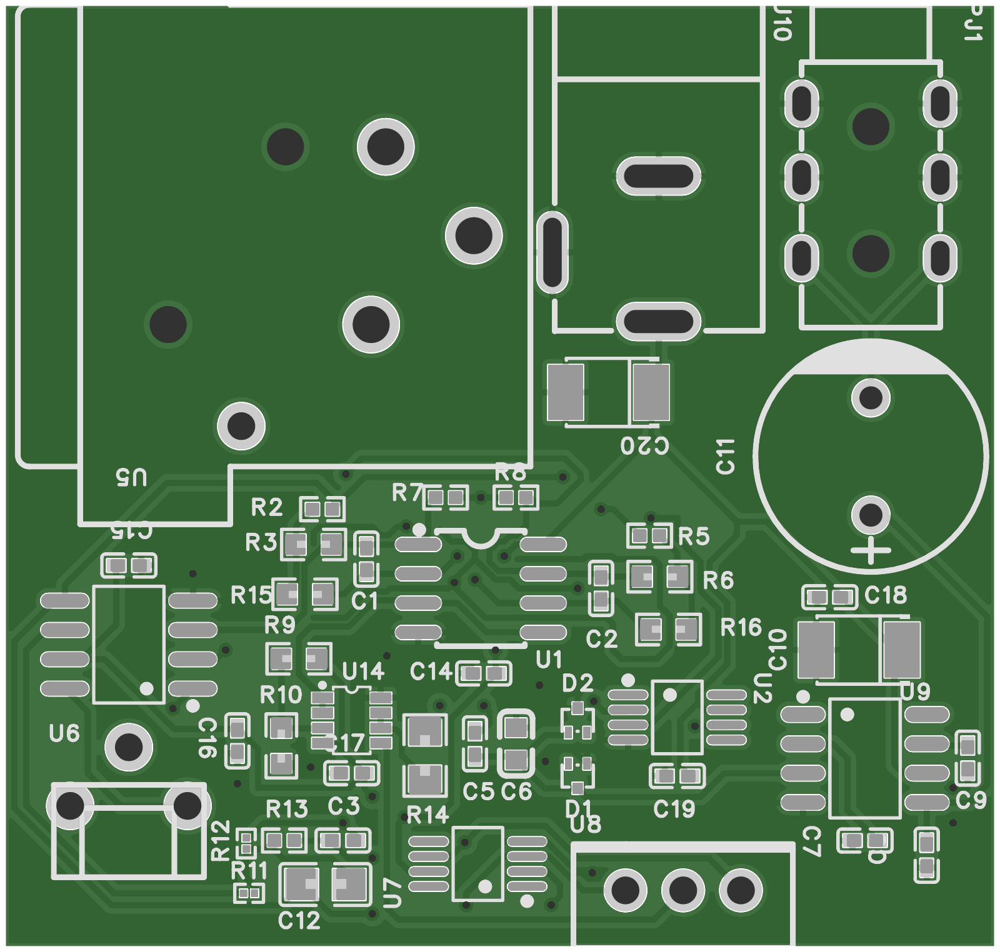

# PCB files / Archivos de PCB

| File | Content |
|---|---|
| `layout-compact.pdf`, `layout-compact-top.png`, `layout-compact-bottom.png` | Compact layout, 43 x 41 mm (manufactured) |
| `gerber-compact.zip` | Fabrication Gerber and drill files of the compact board |
| `gerber-render-top.png` | Top side rendered from those Gerbers |
| `layout-wide.pdf`, `layout-wide-top.png`, `layout-wide-bottom.png` | Earlier wide layout (not manufactured) |
| `layout-long-alternative-top.png` | Long alternative layout by Tania Romero, 77 x 28 mm (not manufactured); project in `../easyeda/` |

| Archivo | Contenido |
|---|---|
| `layout-compact.pdf`, `layout-compact-top.png`, `layout-compact-bottom.png` | Diseño compacto, 43 x 41 mm (fabricado) |
| `gerber-compact.zip` | Archivos Gerber y de taladrado de la placa compacta |
| `gerber-render-top.png` | Cara superior generada desde esos Gerber |
| `layout-wide.pdf`, `layout-wide-top.png`, `layout-wide-bottom.png` | Diseño ancho anterior (no fabricado) |
| `layout-long-alternative-top.png` | Diseño largo alternativo de Tania Romero, 77 x 28 mm (no fabricado); proyecto en `../easyeda/` |

